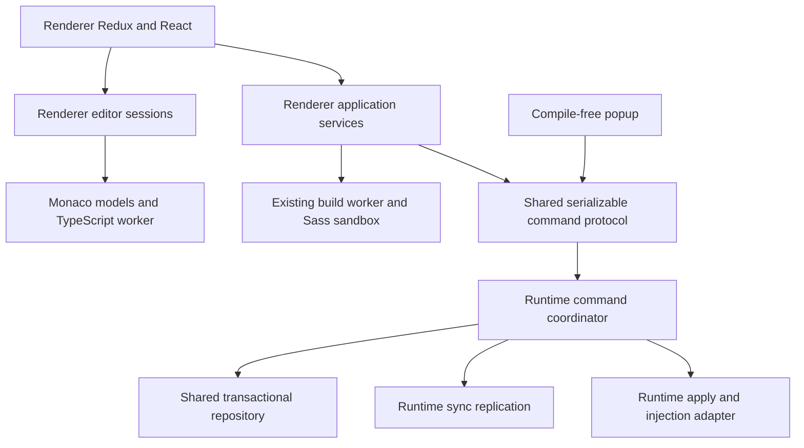

# Incremental architecture refactor design

Status: Implemented with opt-in local-storage/sync rollout and external release gates. Date: 2026-10-14.

## Recommendation

Refactor this extension in place. Keep `renderer`, `runtime`, `shared`, and `monaco`, their existing aliases, React, Redux Toolkit, Monaco, Webpack, the TypeScript build worker, and the Sass sandbox. The existing publication service, workspace projection, reconciliation coordinator, and compiler transports already provide useful migration seams. A replacement extension would discard these working mechanisms and require recreating the same behavior.

The first delivery is an internal boundary refactor. Local transactional storage and browser execution changes are later migrations with independent gates. Completing the early deliveries is useful even if a later migration proves unsuitable.

This document refines the six ADRs proposed in the chat. The accompanying [implementation plan](../superpowers/plans/2026-10-14-incremental-architecture-refactor.md) defines the work. Implementation results, rollout gates and amendments are recorded in [refactor validation](refactor-validation.md).

## Pre-refactor evidence

Paths below are relative to the repository root.

| Existing seam                         | Source                                                                                 | Preserve                                                                               |
| ------------------------------------- | -------------------------------------------------------------------------------------- | -------------------------------------------------------------------------------------- |
| Ordered source/artifact publication   | `packages/renderer/src/shared/services/userscript-publication.ts`                      | Serialization, freshness observations, deletion protection, toggle/effect ordering     |
| Snapshot save and formatting          | `packages/renderer/src/shared/services/draft-save-lifecycle.ts`                        | Later typing remains dirty; stale formatting cannot replace newer model text           |
| Workspace planning and reconciliation | `packages/renderer/src/shared/services/workspace-sync-plan.ts`, `workspace-service.ts` | One Monaco synchronization owner; dirty-model protection; desired-state signatures     |
| Storage observation                   | `packages/renderer/src/shared/services/storage-reconciliation.ts`                      | Incomplete manifests do not delete known scripts; conflicts preserve drafts            |
| Compiler lifecycle                    | `packages/renderer/src/sandbox/compiler-requests.ts`, `compiler-transports.ts`         | Correlated requests, timeouts, worker isolation, Sass sandbox isolation                |
| Runtime planning                      | `packages/runtime/src/ide/injection-plan.ts`, `scripts.ts`                             | Matching, dependency ordering, freshness checks, targeted application, CSS replacement |
| Lightweight popup                     | `packages/renderer/src/popup/popup-store.ts`                                           | Load and toggle without importing Monaco, Sass, or the compiler                        |

Observed constraints: sources use compressed/chunked sync v2; artifacts use local storage; publication ownership is currently per renderer context; import discovery uses lightweight source patterns; compiled output uses TypeScript AST transforms; Monaco URIs currently incorporate module aliases. Test scripts exist in the current `package.json`, despite older AGENTS.md statements. `playwright.config.ts` requests `bypassCSP`, but the extension fixture creates its own persistent context without forwarding that option. Establish effective behavior in the fixture rather than inferring it from project configuration; injection compatibility requires explicit enforced-CSP checks.

## Behavior contract

- Preserve script CRUD, metadata autosave, enable/disable, popup matching, URL testing, all themes/preferences, command palette, layout restoration, import/export, and diagnostics navigation.
- Keep `scripts/<module>/main` and `scripts/<module>/types` public import paths. Keep `window.__INVERT_SHARED__` execution semantics and supported import/export forms during this refactor.
- Keep three draft buffers: `typescript`, `scss`, and `typeDefinitions`. Normal source saves format the focused buffer and persist the draft snapshot; declaration-pane saves retain their current no-build/no-apply behavior.
- Live output may compile unsaved sources but never publishes them or makes them injectable.
- Metadata changes never implicitly save dirty source buffers. A save completion never clears newer typing or applies old formatting to it.
- Preserve existing source-saving permissiveness for non-shared script imports. Report their runtime unavailability explicitly; do not quietly turn them into shared modules or reject previously allowed saves.
- Ordinary shared dependencies initialize before consumers. Unsupported syntax remains a structured diagnostic. Cyclic graphs and failed dependencies get explicit execution errors, without discarding the saved source.
- Disable removes tracked CSS and prevents future execution; it cannot undo arbitrary JavaScript effects. Explicit reapply may execute JavaScript again.
- Automatic execution remains top-frame-only. No SPA rerun, all-frame execution, npm bundling, new privileged userscript API, or automatic JavaScript teardown is added.
- Continue syncing saved source and suitable preferences. Move device/window layout and recovery checkpoints locally only during their specified migration, carrying the existing values forward.
- Keep new-script defaults and transfer JSON behavior unchanged. Imports continue compiling the batch before publication; the transactional backend may strengthen publication to all-or-nothing.

## Target boundaries

| Package    | Final responsibility                                                                                     |
| ---------- | -------------------------------------------------------------------------------------------------------- |
| `renderer` | React, Redux projections, editor-session/application services, compiler hosts, UI feedback               |
| `runtime`  | Command handling, local write coordination, sync ingestion/outbox processing, registration, page effects |
| `shared`   | Serializable domain contracts, repository adapters, pure graph/rule functions, compatibility codecs      |
| `monaco`   | Monaco models, language service adapter, completion, declaration acquisition, themes                     |

Keep TypeScript AST implementation reachable only from worker entry points. Shared contracts and pure graph code must not bring the TypeScript compiler into popup/background bundles. No package may import renderer Redux types except renderer adapters. Existing flat shared import paths can remain compatibility exports while implementations become focused modules.

## ADR-001: Coordinate durable writes in the background

**Status:** Implemented; background authority activates with local document storage. Legacy writers also use background admission.

**Context:** Per-window publication queues cannot serialize options, popup, and other IDE windows together. Moving the same promise map to a service worker would still lose ownership on termination.

**Decision:** Route script mutations, module changes, build-setting changes, imports, conflict resolutions, and remote ingestion through validated commands. Compilation stays in the options worker/sandbox. Commands carry immutable prepared inputs, expected revisions, and request IDs. IndexedDB transactions commit sources, eligible artifacts, operation receipts, and pending effects together. Duplicate requests return the persisted receipt. Retryable effects reread current intent before acting.

**Consequences:** More messaging and a durable receipt/outbox model; one local write path with restart-safe commits. Page JavaScript cannot be made exactly-once across a crash: mark an interrupted execution as unknown and require explicit reapply rather than blindly replaying it. CSS and registration reconciliation are retryable. Validation checks sender identity, command schemas, source/artifact identities, and current dependency revisions. This is local coordination, not cross-device consensus.

**Alternatives:** Keep per-window queues (simpler, insufficient across windows); move compilation into the background (unnecessary bundle/lifecycle/CSP complexity).

## ADR-002: Encapsulate editing in sessions while retaining Redux

**Status:** Implemented over the existing draft reducers, with local recovery and stable Monaco model identity.

**Context:** The current reducers already handle dirty baselines, save ownership, conflicts, and storage echoes. Removing them simultaneously with changing storage would combine unrelated risks.

**Decision:** Introduce an editor-session facade for capture, selection flush, model attachment, explicit remote replacement, and save acknowledgement. Redux continues holding serializable draft snapshots/baselines during migration; Monaco owns live edit history. The facade captures live models at command boundaries, rather than relying on a delayed store mirror. Only one reconciliation owner may update models. Reducing duplicate text snapshots is a later optimization, not a prerequisite.

**Consequences:** Clear ownership without throwing away tested reducers. Alias-rename undo acceptance established the need for stable ID-based URIs. These are now implemented with stock TypeScript path aliases; public import specifiers remain unchanged. A custom worker/resolver remains deferred.

**Alternatives:** Replace Redux or remove draft strings immediately (little demonstrated benefit, large regression surface).

## ADR-003: Use local transactions and replicate through sync

**Status:** Implemented with verified shadow import and explicit local/verified-sync activation. Personal-profile and signed-in transport rollout remain gated.

**Context:** Source and artifact writes currently cross two nontransactional storage areas. Compression/chunking solves individual-item size issues but not total sync capacity or partial arrival.

**Decision:** Add an IndexedDB repository for source revisions, artifacts, operation receipts, tombstones, replication heads/conflicts, and outboxes. Keep v2 readers for migration. A v3 sync format uses immutable revision-qualified chunks, byte-length and SHA-256 verification, causal parents, and explicit tombstones. Promote only complete verified revisions. Concurrent heads are retained as conflicts; timestamps are display metadata, not conflict resolution. Local commit success and sync delivery status are distinct.

**Consequences:** Migration and replication code; atomic local publication and recoverable remote ingestion. Preserve all legacy records until migration is verified. Rollback before cutover is a backend switch. After v3 writes, downgrade is a controlled export/restore operation; it cannot be advertised as a safe flag flip. The supported release cohort must upgrade before v3 is enabled on its shared profile; older extensions cannot be retroactively made v3-aware.

**Alternatives:** Continue direct sync writes behind adapters (valid early delivery); dual-write forever (two competing authorities).

## ADR-004: Share a module-analysis contract

**Status:** Implemented; worker AST manifests feed runtime planning and dirty workspace acquisition. Established import syntax is preserved.

**Context:** Editor discovery, save validation, AST transforms, and runtime traversal currently have separate interpretations of imports.

**Decision:** Analyze imports with TypeScript in the build worker and return a serializable graph manifest alongside artifacts. Graph nodes distinguish runtime imports, erased type imports, unsupported syntax, unresolved aliases, and imports of non-shared sources. Editor completion, publication validation, affected-consumer calculation, and runtime planning consume that contract. Lightweight discovery may remain a provisional UI hint while worker analysis is pending, never the final execution decision.

**Consequences:** Async analysis coordination, explicit cycle policy, and graph invalidation. Preserve the existing namespace transform; replacing it with bundled ESM would change evaluation/identity semantics. Declaration-only saves persist without JS compilation; their type graph refreshes independently.

**Alternatives:** Share regexes (small but insufficient for multiline/type-only semantics); introduce a new general bundler (outside congruent scope).

## ADR-005: Introduce a userScripts execution adapter

**Status:** One-off MAIN adapter implemented and exercised with enforced CSP and permission revocation. Automatic registration is deferred to preserve timing. Chrome 135-specific release acceptance remains open.

**Context:** User-authored code currently runs through `scripting.executeScript` plus eval. Browser-native user-script execution is a better target, but changes permissions, enablement, CSP behavior, and timing.

**Decision:** Extract the current executor first, then implement an adapter using `chrome.userScripts.execute` with `MAIN` to preserve page access. The proposed new API release floor is Chrome 135, where one-off execution is available. Keep legacy navigation triggers in the first cutover. Add registered automatic execution only after glob, timing, dependency initialization, and CSS compatibility are established. Explicitly handle disabled/revoked permission; do not bypass that choice through the old executor. Keep CSS APIs separate.

**Consequences:** Product-facing permission/onboarding change. Chrome 138+ uses an extension-specific Allow User Scripts toggle; older supported Chrome uses Developer mode. Main-world compatibility must be measured under actual page CSP. Registration timing may be a deliberate product change; `document_idle` is not automatically equivalent to the current webNavigation completion trigger. Reconcile registrations on update and enablement recovery.

**Alternatives:** Keep the extracted legacy executor for earlier stages; switch worlds (would change access to page globals).

## ADR-006: Keep language and build work off the UI thread

**Status:** Implemented with existing workers and bounded, versioned declaration acquisition. Unsupported resolution rules fail visibly.

**Context:** Worker compilation and stock Monaco intelligence already exist. A new language server is not necessary to create sound application boundaries.

**Decision:** Keep the built-in Monaco TypeScript worker and controlled active ambient declarations; expose language operations through a small adapter. Version external declaration caches, deduplicate acquisition, bound requests/bytes, and reject stale results. Identify explicit runtime/type package versions without silently changing existing CDN URLs. A project-aware worker is deferred unless declaration-isolation acceptance tests fail under the required UI.

**Consequences:** Less implementation churn; the current single-active-script model remains the supported baseline. Full simultaneous independent TypeScript projects would need another decision and tests.

**Alternatives:** Full LSP stack/custom worker immediately (greater adapter cost without a current product requirement).

## Nonfunctional and release requirements

- Preserve offline editing/building with bundled tools. First-time uncached external library/type acquisition may still require a network connection.
- Retain `scripts/check-manifest.mjs` output checks and current 50 KiB background / 400 KiB popup budgets. If unavoidable new storage runtime overhead exceeds a budget, document the measured cause before intentionally adjusting it; never remove the check.
- Record baseline startup/storage/action counts using existing startup tests. Avoid per-keystroke full-project analysis or full sync reads. Do not add arbitrary performance targets without baseline evidence.
- No worker promise or async database/network operation may be held open inside an IndexedDB transaction. Precompute immutable build/hash inputs, then perform a short conditional transaction.
- Preserve recoverable sources on migration, quota, decoding, build, and runtime failures. Never automatically clear an unreadable database or overwrite an incomplete remote revision.
- Keep actual browser/API checks separate from mocked unit checks. CSP bypass tests cannot establish real-CSP compatibility.

## Official references checked on 2026-10-14

- [Chrome storage](https://developer.chrome.com/docs/extensions/reference/api/storage): sync quotas and storage-area behavior constrain replication.
- [Service-worker lifecycle](https://developer.chrome.com/docs/extensions/develop/concepts/service-workers/lifecycle): global memory is not durable; workers can terminate unexpectedly.
- [User Scripts API](https://developer.chrome.com/docs/extensions/reference/api/userScripts): permission/enablement, worlds, one-off execution availability, and update registration recovery.

The implementation must recheck these constraints at the API cutover; an adapter prototype alone is not release evidence.
